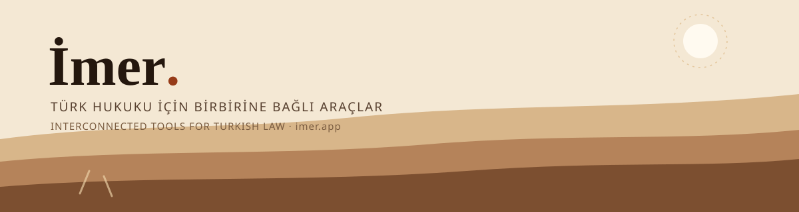

# Hasan İmer

**Avukat · Yazılım geliştirici** — Avukatlık yaparken karşılaştığım sorunlar için araçlar geliştiriyorum: hesaplayıcılar, UYAP belge araçları, karar ve mevzuat doğrulama altyapısı.

**Attorney · Software developer** — I build the tools I need in my own practice: calculators, UYAP document tooling, and case-law / statute verification infrastructure.

Merkez: **[imer.app](https://imer.app)** — bütün projelerin haritası / the map of everything below.

## Güneş sistemi / The system

imer.app'deki harita gibi: merkezde İmer Hukuk Araçları, etrafında Legaluga altyapısı, ürünler ve köprüler.

| Katman | Nedir | Bağlantı |
| --- | --- | --- |
| Çekirdek | **İmer Hukuk Araçları** — 200+ ücretsiz hesaplama ve belge aracı | [imer.av.tr](https://imer.av.tr) |
| Altyapı | **Legaluga** — kaynağı kayıtlı karar ve mevzuat verisi, atıf doğrulama motoru, MCP sunucusu | [legaluga.com](https://legaluga.com) |
| Ürünler | UYAP Asistanı, UDF Editor, Atıf Denetimi, Karar Kütüphanesi, Legaluga Mobil | [imer.app](https://imer.app) |
| Köprüler | Skill kütüphanesi, İmer İmza Köprüsü, Yaptırım Aynası | [imer.app](https://imer.app) |

**Ölçek (Ekim 2026):** 11,05 milyon karar künyesi Atıf Denetimi havuzunda · 3.057 karar tam metniyle Karar Kütüphanesi'nde · 200+ araç imer.av.tr'de · 53 araç Legaluga MCP sunucusunda.

**Scale (Oct 2026):** 11.05M case citations in the citation-check pool · 3,057 full-text decisions · 200+ tools · 53 MCP tools.

## Öne çıkan projeler / Featured projects

| Proje | Açıklama |
| --- | --- |
| [kira-hukuku-skill](https://github.com/hasanimer/kira-hukuku-skill) | Kira tespit davaları için karar havuzu, mevzuat ve kaynak doğrulamalı Codex skill paketi |
| [avukat-vergi-skill](https://github.com/hasanimer/avukat-vergi-skill) | Serbest çalışan avukatın vergi işleri için Claude Code skill'i: e-SMM, AAÜT vekalet ücreti, CMK/KDV tevkifatı, geçici ve yıllık vergi |
| [legaluga-uyap-ui](https://github.com/hasanimer/legaluga-uyap-ui) | Legaluga UYAP Asistanı arayüzü (MIT): UYAP dosyalarını isimle bulup tek tıkla açan araçlar |
| [legaluga-yaptirim-aynasi](https://github.com/hasanimer/legaluga-yaptirim-aynasi) | OFAC SDN ve Consolidated listelerinin resmî SHA-256 ile doğrulanmış GitHub Release aynası |
| [borsa-mcp](https://github.com/hasanimer/borsa-mcp) | MCP server for Turkish & American stock exchange and fund data |

## İlkeler / Principles

- **Veri kullanıcıda kalır** — Belge imzalanırken makineden çıkmaz, çalışma kayıtları tarayıcıda durur. / Data stays on the user's machine.
- **Kaynağı olmayan cümle yok** — Hukuki bilgi gösteriliyorsa arkasındaki karar ya da madde de gösterilir. / No statement without its source.
- **Uydurma sayı yok** — Ekrandaki her rakam gerçek bir kayıttan gelir. / No invented numbers.

## GitHub istatistikleri / GitHub stats

## İletişim / Contact

- [imer.app](https://imer.app) — portfolyo ve proje haritası / portfolio & project map
- [imer.av.tr](https://imer.av.tr) — ücretsiz hukuk araçları / free legal tools
- [legaluga.com](https://legaluga.com) — karar ve mevzuat altyapısı / legal-data infrastructure
- [LinkedIn](https://www.linkedin.com/in/hasanimer/) · E-posta: info@legaluga.com
